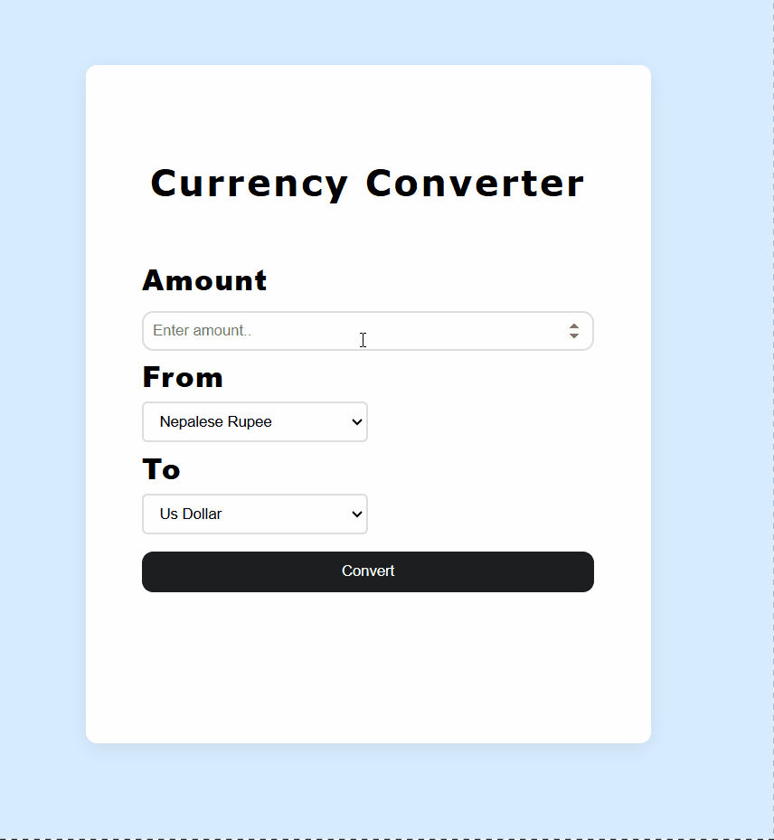
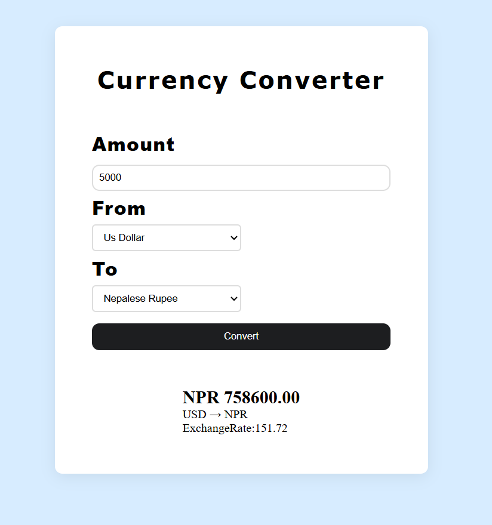

# Currency-Converter
This is the site where people can convert one currency money to another currency money with the current exchange rate. for now i have add only 9 countries.

here's an AWESOME gif of my project!


## HOW THIS WAS MADE
I made this because people often need to convert one currency money to another.and i also want to build something that can be used in daily life.And want to sharp by backend and frontend skill also so i think of making this to see how api work and deliver things to frontend .

## What does it do
it simply helps us to convert one currency money to another currency with exact current exchange rate.


## Tech stack
1. HTML
2. CSS
3. Javascript
4. Nodejs
5. Express js

## Demo Link
[Here is live demo of my project](https://currency-converter-azure-one.vercel.app/index.html)

### Development

1. Clone the source code to your device
```sh
git clone https://github.com/Saurav-Khanal/Currency-Converter.git
```

2. Install the project's dependencies
```sh
npm install
```

3. Start the development server on `localhost:3000`
```sh
node server.js
```

4. Open the project in your browser
```sh
http://localhost:3000
```

## Screenshots
;


## Problem i faced
i didn't faced major problem here i am able to made this project using my existing knowledge smoothly.i forget only some syntax only in js and in html like for that dropdown select.overall this project went smoothly.


## AI DISCLOSURE
I used ai to know the country ```exact code like USD,NPR etc ```that i have to send while fetching api to know about its exhange rate.

